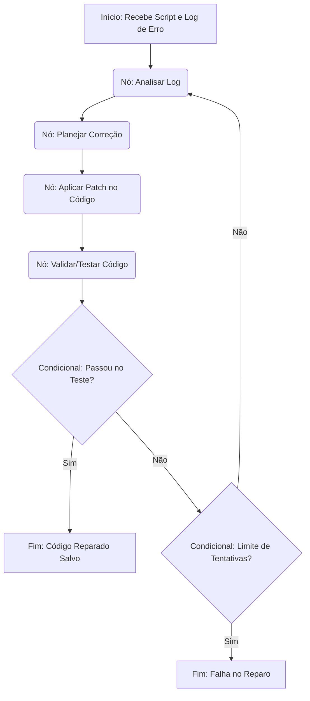
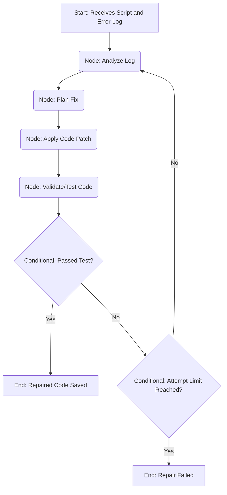

# 🤖 Logger Agents - Autonomous Code Repair Agent

Um agente autônomo construído com **LangChain** e **LangGraph** focado em analisar logs de execução de aplicações Python, identificar a causa raiz de falhas e aplicar correções (patches) dinamicamente no código-fonte.

*(English version available below / Versão em inglês disponível abaixo)*

---

## 🎯 Objetivo do Projeto

O Logger Agents atua como um "AI Engineer" em loop. Quando um script falha, o agente recebe o log de erro e o código original, planeja uma solução e aplica a correção de forma iterativa. Todo o histórico de execução e tomada de decisão do agente é rastreado e armazenado no **Google BigQuery** para auditoria e análise de performance.

## 🏗️ Arquitetura

O projeto utiliza um grafo de estado (State Graph) do LangGraph para orquestrar as etapas de reparo. O fluxo típico inclui:

1. **Análise de Log:** Ingestão do erro e do código afetado.
2. **Planejamento:** O LLM define qual a melhor abordagem para corrigir o problema.
3. **Aplicação do Patch:** Ferramentas customizadas (Tools) alteram os arquivos necessários.
4. **Validação:** Verificação se o código modificado resolve o problema original.
5. **Persistência:** Salvamento do estado final e das métricas no BigQuery.



## 📂 Estrutura do Repositório

-   `core/`
    *   `graph.py`: Definição da topologia do grafo (arestas e roteamento).
    *   `nodes.py`: Lógica de execução de cada passo do grafo.
    *   `state.py`: Tipagem e gerenciamento do estado compartilhado entre os nós.
    *   `tools.py`: Ferramentas que o LLM utiliza para ler/escrever código.
    *   `prompts.py`: Templates de sistema para orientar as respostas do LLM.
    *   `bigquery_saver.py`: Integração para salvar checkpoints e histórico.
-   `sql/`: Scripts de setup do banco de dados (ex: `setup_bigquery.sql`).
-   `utils/`: Funções auxiliares.
-   `main.py`: Ponto de entrada para execução do agente.

## 🚀 Como Executar

### Pré-requisitos

-   Python 3.10+
-   Conta no Google Cloud com acesso ao BigQuery (e credenciais configuradas).
-   Chave de API de um LLM suportado (ex: Google Gemini, OpenAI).

### Instalação

1. Clone o repositório:
   ```bash
   git clone https://github.com/seu-usuario/logger-agents.git
   cd logger-agents
   ```

2. Crie um ambiente virtual e ative-o:
   ```bash
   python -m venv venv
   source venv/bin/activate  # No Windows: venv\Scripts\activate
   ```

3. Instale as dependências:
   ```bash
   pip install -r requirements.txt
   ```

4. Configure as variáveis de ambiente:
   Crie um arquivo `.env` na raiz do projeto e adicione suas chaves (veja `.env.example` se disponível):
   ```env
   GOOGLE_API_KEY=sua_chave_aqui
   GOOGLE_APPLICATION_CREDENTIALS=caminho/para/sua/service-account.json
   ```

5. Inicialize as tabelas no BigQuery:
   Execute os comandos contidos em `sql/setup_bigquery.sql` no seu console do GCP para criar as tabelas de auditoria.

### Uso

Para iniciar o agente passando um arquivo de log e o script alvo, execute:

```bash
python main.py
```
*(Certifique-se de configurar os caminhos dos arquivos alvo dentro do `main.py` ou via argumentos de linha de comando, conforme a implementação atual).*

## 🛠️ Tecnologias Utilizadas

-   [LangChain](https://python.langchain.com/) - Framework para aplicações impulsionadas por LLMs.
-   [LangGraph](https://python.langchain.com/docs/langgraph) - Criação de agentes cíclicos e controle de estado.
-   [Google BigQuery](https://cloud.google.com/bigquery) - Data warehouse para logs e estados.
-   [Python](https://www.python.org/) - Linguagem base.

---
---

# 🤖 Logger Agents - Autonomous Code Repair Agent (English)

An autonomous agent built with **LangChain** and **LangGraph** focused on analyzing execution logs of Python applications, identifying the root cause of failures, and dynamically applying patches to the source code.

## 🎯 Project Objective

Logger Agents acts as an "AI Engineer" in a loop. When a script fails, the agent receives the error log and the original code, plans a solution, and applies the fix iteratively. The entire execution history and agent decision-making process is tracked and stored in **Google BigQuery** for auditing and performance analysis.

## 🏗️ Architecture

The project uses a LangGraph State Graph to orchestrate the repair steps. The typical flow includes:

1. **Log Analysis:** Ingestion of the error and affected code.
2. **Planning:** The LLM determines the best approach to fix the problem.
3. **Patch Application:** Custom tools (Tools) alter the necessary files.
4. **Validation:** Verification if the modified code solves the original problem.
5. **Persistence:** Saving the final state and metrics to BigQuery.



## 📂 Repository Structure

-   `core/`
    *   `graph.py`: Graph topology definition (edges and routing).
    *   `nodes.py`: Execution logic for each graph step.
    *   `state.py`: Typing and management of the shared state between nodes.
    *   `tools.py`: Tools the LLM uses to read/write code.
    *   `prompts.py`: System templates to guide LLM responses.
    *   `bigquery_saver.py`: Integration to save checkpoints and history.
-   `sql/`: Database setup scripts (e.g., `setup_bigquery.sql`).
-   `utils/`: Auxiliary functions.
-   `main.py`: Entry point for agent execution.

## 🚀 How to Run

### Prerequisites

-   Python 3.10+
-   Google Cloud Account with BigQuery access (and configured credentials).
-   API Key from a supported LLM (e.g., Google Gemini, OpenAI).

### Installation

1. Clone the repository:
   ```bash
   git clone https://github.com/your-username/logger-agents.git
   cd logger-agents
   ```

2. Create and activate a virtual environment:
   ```bash
   python -m venv venv
   source venv/bin/activate  # On Windows: venv\Scripts\activate
   ```

3. Install dependencies:
   ```bash
   pip install -r requirements.txt
   ```

4. Configure environment variables:
   Create a `.env` file in the project root and add your keys (see `.env.example` if available):
   ```env
   GOOGLE_API_KEY=your_key_here
   GOOGLE_APPLICATION_CREDENTIALS=path/to/your/service-account.json
   ```

5. Initialize BigQuery tables:
   Execute the commands contained in `sql/setup_bigquery.sql` in your GCP console to create the auditing tables.

### Usage

To start the agent passing a log file and the target script, run:

```bash
python main.py
```
*(Make sure to configure the target file paths inside `main.py` or via command-line arguments, depending on the current implementation).*

## 🛠️ Technologies Used

-   [LangChain](https://python.langchain.com/) - Framework for LLM-driven applications.
-   [LangGraph](https://python.langchain.com/docs/langgraph) - Creation of cyclical agents and state control.
-   [Google BigQuery](https://cloud.google.com/bigquery) - Data warehouse for logs and states.
-   [Python](https://www.python.org/) - Base language.